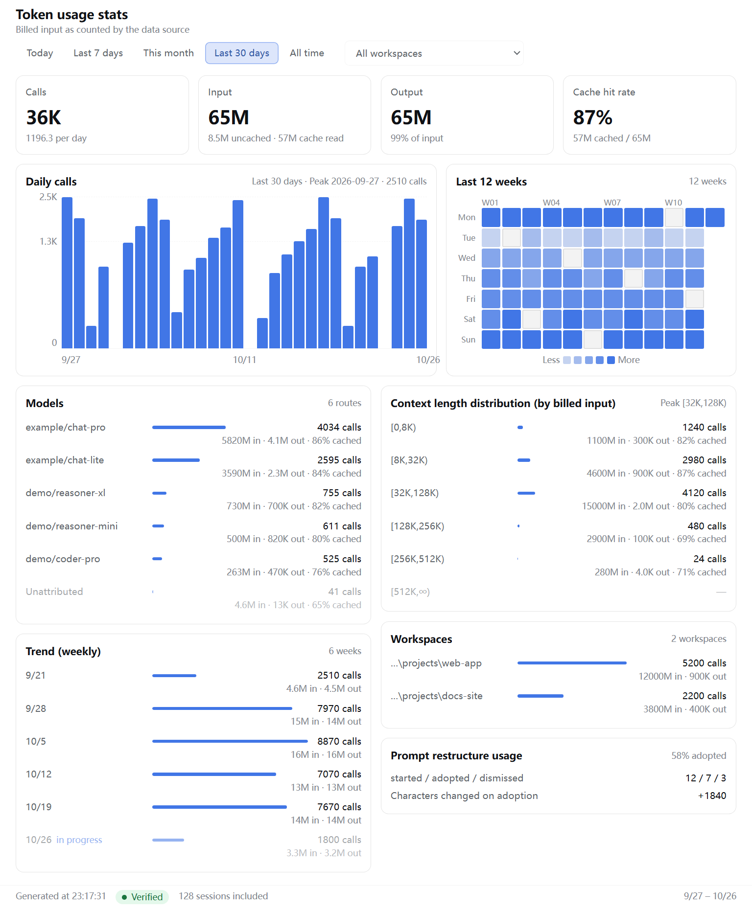
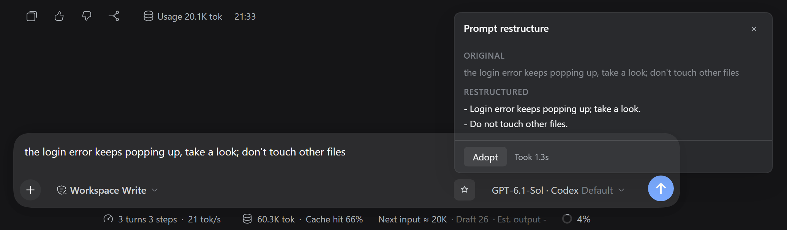

# dsh-tokstats

[简体中文](./README.md) | English

<p align="center">
  <a href="https://github.com/PlusQi/dsh-tokstats/tags"></a>
  <a href="./LICENSE"></a>
  <a href="https://github.com/topics/dsh-plugin"></a>
  <a href="https://awesome-dsh-plugin.com"></a>
</p>

A possibly useful [DeepSeek Harness (DSH)](https://github.com/deepseek-ai/deepseek-harness) token usage plugin, **dsh-tokstats**: where your tokens went, in three components.

| Component | What it is for | Where you see it |
| --- | --- | --- |
| **tokstats** | Cross-session stats on where your tokens went: four headline figures, context length distribution, a 12-week heatmap and weekly trend, plus workspace and model rankings | "Token usage stats" in the sidebar → a full panel |
| **tokprev** | Tells you roughly how many tokens the next turn will feed in, before you send | One grey line at the bottom of the input box |
| **promptopt** | Turns a spoken draft into a structured prompt | Star button at the right end of the toolbar under the input box |

Installation is [further down](#install).

## tokstats: who stole my tokens



How many tokens were spent, and who spent them? "Token usage stats" in the sidebar opens a full panel — four headline figures on top, daily calls and the 12-week heatmap in the middle, then context length distribution, the weekly trend, workspace and model rankings, and finally prompt restructure usage.

| Block | What it answers |
| --- | --- |
| **Four metric cards** | How much did the **selected window** use? How much did caching save? (Follows the window switcher) |
| **Daily calls** | Which of these days was heavy? (Window follows the switcher, never shorter than 7 days — the card header prints the actual span; beyond 30 columns days are merged; sits next to the heatmap with date ticks aligned to each bar) |
| **Last 12 weeks** | Which days were active, which were idle? Click a day to see just that day |
| **Context length distribution** | How long are my requests? How much sits in long ones? Billed input binned into six tiers: `[0,8K)` / `[8K,32K)` / `[32K,128K)` / `[128K,256K)` / `[256K,512K)` / `[512K,∞)` |
| **Trend (weekly)** | Is this week heavier than last? One bar per week; the current week is dimmed and marked "in progress"; weekly totals always add up to the grand total |
| **Models** | Which model carries the usage? Counted by `provider/model`; samples with no route land in "Unattributed" placed last, so the rows add up to the total |
| **Workspaces** | Which project carries the usage? A picker switches to a single workspace; subagent usage merges into the root workspace |
| **Prompt restructure usage** | Is promptopt actually used? Started / adopted / dismissed counts and adoption rate |

Five windows: **today** / last 7 days / this month / last 30 days / all time, today by default — the window drives the four metric cards plus the distribution, ranking and weekly blocks. The heatmap always covers the last 12 weeks regardless of the switcher; the daily bar chart follows the switcher but is never shorter than 7 days (the today window still draws 7 bars, and beyond 30 columns days are merged), with the actual span printed in its card header.

## tokprev: count the turn before you send


The official ContextMeter already shows how long the context is. What it does not tell you is **how much the draft you are typing right now will add**. tokprev fills only that gap.

> Next input ≈ 20K · Draft 17 · Est. output -

- **Next input** = the current context plus the draft estimate, moving as you type;
- **Draft** = a local estimate from character count; no request is made;
- **Est. output** = the range of the last few turns' real output. It only counts finished turns, so a new session — or the turn currently running — shows `-` (as above), turning into a range like `1.5K–3K` once a turn completes;
- While a turn is running the whole line hides; with no real-request anchor the figure is prefixed with `*`, meaning heuristic only.

## promptopt: tidy up a spoken draft



Takes a draft like "the login error keeps popping up, take a look; don't touch other files" and **faithfully restructures** it into input a model parses more easily. It does not expand it into an execution plan, and it does not add facts, paths, constraints or steps the draft does not contain.

- **How to use it**: click the star button → compare original against restructured in the popover → click **Adopt** only when you are happy, and only then is it written back;
- **Greyed out** (hover for the reason): the draft is empty, or it contains a reference chip, an image attachment or a `/` command — adopting is a full-text replacement, so a reshuffle would break reference offsets and image ownership;
- **Adopt** takes the draft snapshot from the moment you clicked and overwrites edits made while waiting — no confirmation dialog;
- It rides the host's existing model route, has no configuration, and creates no API key;
- Closing, Esc and clicking outside all count as cancel and abort the call.

## Install

Prerequisites: Node.js, git, pnpm.

```powershell
npm i -g pnpm
npx @deepseek-ai/dsh plugin --profile web add github:PlusQi/dsh-tokstats#v0.9.0
```

**Restart the host process afterwards** (profile composition only happens at startup), then reload the page. No config file, no API key, no build step.

- **The command above carries `#v0.9.0` and installs a pinned snapshot** — that is the recommended form;
- To follow the latest, drop `#v0.9.0` and use `add github:PlusQi/dsh-tokstats` — **that installs the tip of the default branch (`master`), not "the latest release"**. Git addresses have no npm-style `latest`; any spec without a `#ref` resolves to the branch HEAD. The marketplace listing's install button uses exactly this bare address, so installing from the store also follows the mainline;
- Local development: `add link:D:\path\to\dsh-tokstats`, edit and restart to see changes;
- If your profile is not called `web`, use yours instead. **The desktop (Electron) app cannot install through the CLI** — the `desktop` profile is owned by the application and the CLI refuses it; use Settings → Plugins inside the app.

## Check these three places

1. The sidebar has a **"Token usage stats"** item; opening it shows four metric cards;
2. The input box has one extra grey line at the bottom; type a few characters and the "Draft" figure moves;
3. The toolbar under the input box has one extra **star button** (between the model select and the send button), enabled once a draft exists.

None of the three? See [Something is broken](#something-is-broken).

## Chinese / English

UI copy follows DSH's **Settings → General → Language**; the pack has no language switch of its own. promptopt is the exception: its **restructured result follows the draft's language**, not the UI language.

## Something is broken

If the plugin UI disappears entirely, work through these in order:

1. **The host version does not match.** This pack pins the exact host version it was tested against; on a mismatch the host silently skips the whole bundle (not even a log line), which looks like "the plugin broke". Run `dsh plugin --profile web list`: if it mentions `is incompatible with dsh …`, that is it;
2. **The host process was not restarted** — only the browser was reloaded;
3. **It went into a different profile, or `DSH_HOME` changed**;
4. **The locale service is disabled** — the UI copy depends on it, and without it the whole bundle does not load.

Other common symptoms:

- **The panel keeps saying "Scanning…"**: the first open scans history once; a few to a dozen seconds is normal;
- **The numbers look lower than expected**: first check the footer for "M skipped (unreadable log)", then check which window you are on;
- **The panel says "Verifying…"**: the host is still checking in the background; the figures on screen are cached values that correct themselves within seconds;
- **promptopt shows "The model call failed"**: the host has no usable model route — check the model configuration.

One thing that is **not** a fault: the "host requirement unknown" chip on the market card. This pack ships from GitHub only and is not published to npm, and the market reads `engines.dsh` from registry packages — so it cannot see this pack's host requirement and the chip stays unknown. The plugin installs and runs normally; for the real compatibility check see item 1 above (`dsh plugin --profile web list`).

## Update and uninstall

```powershell
# Update
npx @deepseek-ai/dsh plugin --profile web update dsh-tokstats

# Uninstall the whole pack
npx @deepseek-ai/dsh plugin --profile web remove dsh-tokstats
```

To temporarily disable one of the components, append to `$DSH_HOME/profiles/<profile>/cordis.patch.yml`:

```yaml
- id: tokprev
  disabled: true
```

Restart to apply. Note that disabling `tokprev` does **not** remove it from the page — as long as any other row of the pack is live, the browser-side bundle still loads; a real per-component off-switch requires splitting that component into its own package (see [docs/MAINTAINING.md](./docs/MAINTAINING.md)).

## Maintenance

Maintainers and AI agents start from [AGENTS.md](./AGENTS.md); the publishing flow and host-side contracts live in [docs/MAINTAINING.md](./docs/MAINTAINING.md), invariant evidence in [docs/INVARIANTS.md](./docs/INVARIANTS.md), and release history in [CHANGELOG.md](./CHANGELOG.md).

## License

[MIT](./LICENSE)
