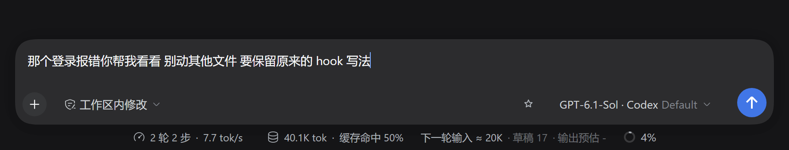
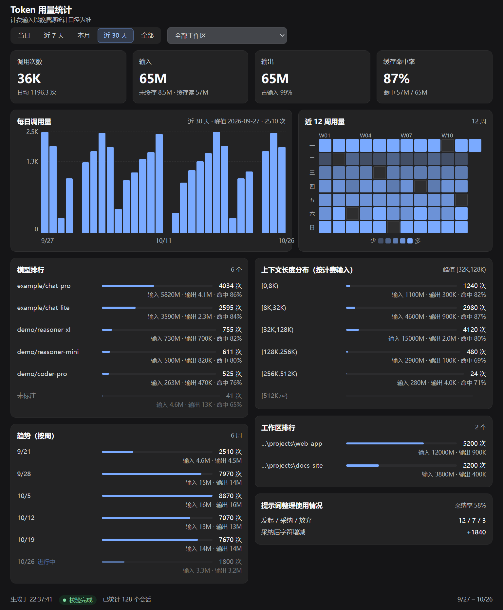
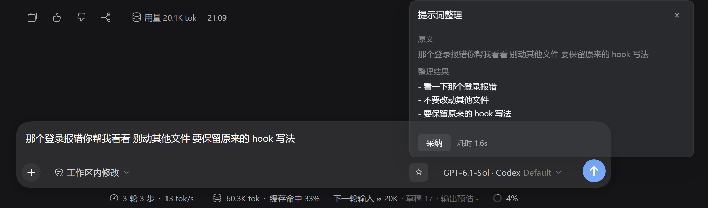

# dsh-tokstats

简体中文 | [English](./README.en.md)

可能有用的 [DeepSeek Harness (DSH)](https://github.com/deepseek-ai/deepseek-harness) token汇总插件，告诉你token花哪了：

| 插件 | 有什么用 | 在哪看到 |
| --- | --- | --- |
| **tokprev** | 发送前告诉你这一轮大概要喂多少 token | Composer 底部一行灰色小字 |
| **tokstats** | 跨会话统计 token 都花在哪儿了 | 侧栏「Token 分析」→ 全局面板 |
| **promptopt** | 把口语草稿整理成结构化提示词 | Composer 工具行右端的星标按钮 |

## 安装

前置：Node.js、git、pnpm。

```powershell
npm i -g pnpm
npx @deepseek-ai/dsh plugin --profile web add github:PlusQi/dsh-tokstats
```

**装完必须重启宿主进程**（profile 组合只在启动时生效），再刷新页面。没有配置文件、没有 API key、没有构建步骤。

- 固定版本：`add github:PlusQi/dsh-tokstats#v0.7.1`
- 本机开发：`add link:D:\path\to\dsh-tokstats`，改完代码重启即生效
- profile 不叫 `web` 就换成你自己的

## 装完看这三处

1. 侧栏多了一项 **「Token 分析」**，点进去有四张指标卡；
2. Composer 底部多了一行灰色小字，打几个字，「草稿」那个数会跟着变；
3. 工具行右端多了一个**星标按钮**（模型选择与发送按钮之间），打了草稿后可用。

三处全没有？看 [出问题了](#出问题了)。

## tokprev：发送前，先算这一轮要花多少

官方 ContextMeter 已经给了上下文长度，它没说的是**你正在输入框里敲的这段草稿还要额外花掉多少**。tokprev 会补上这个。



> 下一轮输入 ≈ 20K · 草稿 17 · 输出预估 -

- **下一轮输入** = 当前上下文 + 草稿估算，边打字边跳；
- **草稿** = 本地按字符数估的，不发请求；
- **输出预估** = 最近几轮真实输出的区间。只统计已结束的轮次，所以新会话或当前轮还没跑完时显示 `-`（上图就是），跑完一轮就变成 `1.5K–3K` 这样的区间；
- 会话正在跑时整行隐藏；没有真实请求锚点时数字前带 `*`，表示纯估算。

## tokstats：谁偷走了我的token

看看token花了多少，谁花得多？



侧栏「Token 分析」进入全局面板：

| 区块 | 它回答什么 |
| --- | --- |
| **四张指标卡** | 这个窗口一共用了多少？缓存省了多少？ |
| **每日调用量** | 哪天用得凶？峰值在哪天？ |
| **上下文长度分布** | 请求有多长？长请求占多大比例？按计费输入分 6 桶：`[0,8K)` / `[8K,32K)` / `[32K,128K)` / `[128K,256K)` / `[256K,512K)` / `[512K,∞)` |
| **趋势（按周）** | 这周比上周多还是少？周合计恒等于总计，不会对不上 |
| **模型排行** | 用量集中在哪个模型？按 `provider/model` 组合计，拿不到路由的归「未标注」排最后，各行之和等于总计 |
| **工作区排行** | 用量集中在哪个项目？可下拉切到单个工作区，子会话归并到根工作区 |
| **提示词整理使用情况** | promptopt 真被用上了吗？发起 / 采纳 / 放弃计数与采纳率 |

时间窗四档：近 7 天 / 本月 / 近 30 天 / 全部，默认近 7 天。打开面板、切档位、切工作区、点刷新时各拉一次数。

## promptopt：把口语草稿摆整齐

把「那个登录报错你帮我看看 别动其他文件」这种草稿，**保真重排**成模型更容易解析的结构化输入。不扩写成执行计划，也不补原文没有的事实、路径、约束、步骤。



- **怎么用**：点星标按钮 → 弹层里原文与整理结果上下对照 → 满意才点**采纳**，只有采纳才写回输入框；
- **按钮置灰**（悬浮有原因）：草稿为空，或含引用 chip、图片附件、`/` 命令——写回是全量替换，重排会破坏引用坐标与图片归属；
- **采纳** 以点击那一刻的草稿快照为准，会覆盖等待期间的编辑，没有二次确认；
- 走宿主已有的模型路由，没有配置项，不新建 API key；
- 关闭、Esc、点弹层外都算取消，会中止这次调用。

## 中文 / English

界面文案跟随 DSH 的 **设置 → 常规 → Language**，插件本身没有语言开关。promptopt 是例外：**整理结果跟随草稿的语言**，不跟界面语言。

## 出问题了

插件 UI 整个不见，按顺序排这几条：

1. **宿主版本对不上。** 本包钉死了实测过的宿主版本，不匹配时宿主会安静地跳过整个包（连日志都不打），表现就是「插件坏了」。跑 `dsh plugin --profile web list`，出现 `is incompatible with dsh …` 就是它；
2. **没重启宿主进程**，只刷新了浏览器；
3. **装到了别的 profile，或换了 `DSH_HOME`**；
4. **locale 服务被禁用了**，界面文案依赖它，缺席时整包不加载。

其它常见现象：

- **面板一直「统计中…」**：首次要扫一遍历史日志，几秒到十几秒正常；
- **数字比你以为的少**：先看页脚有没有「跳过 M 个（日志不可读）」，再确认当前是哪个时间档；
- **面板显示「校验中…」**：后台还在核校，屏上是缓存值，几秒后自动变准；
- **promptopt 报「模型调用失败」**：宿主没有可用模型路由，检查模型配置。

## 更新与卸载

```powershell
# 更新
npx @deepseek-ai/dsh plugin --profile web update dsh-tokstats

# 卸载整个包
npx @deepseek-ai/dsh plugin --profile web remove dsh-tokstats
```

想临时关掉其中一个，在 `$DSH_HOME/profiles/<profile>/cordis.patch.yml` 里加：

```yaml
- id: tokprev
  disabled: true
```

重启生效。注意关 `tokprev` **不会**让它从页面上消失——只要包里还有别的行活着，浏览器侧整包就仍在加载；要真正按插件独立开关，只能拆成独立包（见 [docs/MAINTAINING.md](./docs/MAINTAINING.md)）。

## 维护

维护者与 AI Agent 从 [AGENTS.md](./AGENTS.md) 进入；发布流程与宿主侧契约在 [docs/MAINTAINING.md](./docs/MAINTAINING.md)，不变量证据在 [docs/INVARIANTS.md](./docs/INVARIANTS.md)，变更记录在 [CHANGELOG.md](./CHANGELOG.md)。

## License

[MIT](./LICENSE)
